# 慢记 SlowRecap —— 项目文档

> 基于艾宾浩斯遗忘曲线的全平台记忆训练工具
> 版本：v1.3.5 ｜ 文档更新：2026-11-13

---

## 一、项目简介

**慢记（slowlyRecord）** 始于 uTools 插件，现已发展为 **uTools / Electron 桌面版 / Web 网页 / 微信小程序 / 抖音小程序 / Android / iOS** 全平台覆盖的记忆训练工具。同一份核心体验：间隔重复到点复习、多场景记忆训练、数据本地存储、多端进度同步。

**核心能力一览**

| 类别 | 功能 |
|------|------|
| 单词记忆 | 间隔重复复习（13 级记忆等级）、拼写练习（听写）、词库管理、划词/划段/截图 OCR 取词 |
| 多场景记忆 | 文本记忆（诗词古文，跟打/填空练习）、数字记忆（图像编码法）、记忆宫殿（轨迹法）、知识库（35+ 知识包刷题）、快捷键记忆（含五笔/双拼）、字母映射、音标学习 |
| 辅助工具 | 多引擎翻译（15+ 引擎）、专注模式悬浮窗、记忆测试（数字/单词/图案/词汇量）、句子库、学习打卡 |
| 数据 | 本地数据库（按平台适配）、坚果云 WebDAV 备份、端到端加密同步码互传、文件导入导出、Anki 互通 |

**在线体验（Web 版）**：<https://slowrecap.cn>

---

## 二、平台矩阵

| 平台 | 技术方案 | 状态 | 构建命令 |
|------|---------|------|----------|
| **uTools 插件（主端）** | Vue 3 + Vite 6 | ✅ 功能最完善 | `npm run build` |
| Electron 桌面版 | Electron + Vue 3 | ✅ 可用 | `npm run build:electron` / `pack:electron` |
| Web 版（PWA） | Vue 3 + Vite 6 | ✅ 可用（`slowrecap.cn`） | `npm run build:web` |
| 微信小程序 | UniApp + Vue 3 | ✅ 可用 | `npm run build:mp-weixin` |
| 抖音小程序 | UniApp + Vue 3 | ✅ 可用 | mobile 目录构建 |
| Android / iOS App | UniApp + Vue 3 | ✅ 可用 | `build:app-android` / `build:app-ios` |

> uTools 端功能最全（专注悬浮窗、uTools 8.0 定时任务、全局划词热键等仅桌面端可用）；小程序/App 端侧重移动复习与拍照加词；Web 端免安装即开即用。各端 UI 与功能略有差异，以 uTools 端为准。

---

## 三、技术架构

### 3.1 仓库结构（Monorepo）

```
slowlyRecord/
├── src/                  # 桌面端：Vue 3 + Vite 6 + Pinia + Element Plus + TS
│   ├── adapters/         # 跨平台抽象层（核心模式，见 3.2）
│   ├── stores/           # Pinia stores（words / textMemory / memory / sync ...）
│   ├── views/            # 页面（Word / Dictation / Translate / TextMemory ...）
│   ├── utils/            # 翻译 API、OCR、同步、词库服务、各模块 *-db.ts 存取层
│   └── router/           # Vue Router（hash 路由）
├── mobile/               # 移动端：UniApp + Vue 3 + Pinia（独立 package.json）
│   ├── src/pages/        # 四个主包页面（index / profile / review / words）
│   ├── src/subPackages/  # 分包：pages-data / pages-memory / pages-tools / 内置词库
│   └── src/utils/language/  # 多语言词库核心（英/日/俄/西/法）
├── public/               # 内置词库、诗词数据、OCR 训练数据、plugin.json、preload
├── electron/             # Electron 主进程（main.cjs，含全局热键划词）
├── scripts/              # 公式/几何图预渲染、SEO 静态页生成等辅助脚本
└── docs/                 # 设计/迁移/评审文档
```

### 3.2 数据库适配器模式

统一的 `DbAdapter` 接口模拟 `utools.db` API，运行时按平台自动选择实现：

- **uTools**：直接代理 `utools.db`（同步 API）
- **Electron / Web**：IndexedDB + 内存缓存（异步预加载后提供同步读写）
- **小程序**：`wx.Storage`

在非 uTools 环境中必须先 `await getDbAdapterAsync()` 再使用 `getDbAdapter()`。跨平台能力（截图、剪贴板、TTS、文件、通知、悬浮窗）一律走 `src/adapters/` 抽象层，业务代码不直接调用 `utools.*` / `wx.*` / IndexedDB。

### 3.3 间隔重复算法

`DEFAULT_INTERVALS`（分钟）：`[1, 5, 30, 360, 720, 1440, 2880, 5760, 10080, 21600, 43200, 129600, 259200, 518400]`

- 单词 `level` 0-12 对应间隔数组下标，到期复习答对按记忆牢固度 +1~3 级（封顶 12），答错每次降 4 级（下限 1）
- level ≥ 12 视为「已记完」，不再出现在待复习列表
- 记忆牢固度（正常/较强/极强）影响升级幅度

### 3.4 构建与平台宏

`vite.config.*.ts` 通过 `define` 注入 `__PLATFORM__`（utools / electron / web）与 `__LOG_LEVEL__`；生产构建以 esbuild `pure` 抹除 debug 日志。三个 Vite 配置共用同一份 `src/`：

- `vite.config.ts` → uTools 插件（输出 `dist/`，`build:upx` 拷贝到 `D:\slowlyRecord-dist` 供 uTools 开发环境运行）
- `vite.config.electron.ts` → Electron（`dist-electron/`）
- `vite.config.web.ts` → Web（`dist-web/`，PWA + SEO 静态页）

### 3.5 测试

Vitest 4 + Testing Library，覆盖 `src/` 与 `mobile/src/`，数据库测试用 `fake-indexeddb`。提交前至少运行 `npm run test:run` 与 `npm run type-check`。

---

## 四、功能模块与界面截图

> 截图优先采用 **uTools 端**（功能最全、UI 完整）；无 uTools 截图的模块采用 Web 版截图（深色主题）补充，已逐张标注平台。

### 4.1 单词复习（核心）

卡片式复习列表：单词（词根词缀颜色区分）、音标、等级标签、发音/翻译/认识/忘记/已记完/删除操作；支持通配符搜索、多维筛选排序、多词库切换。

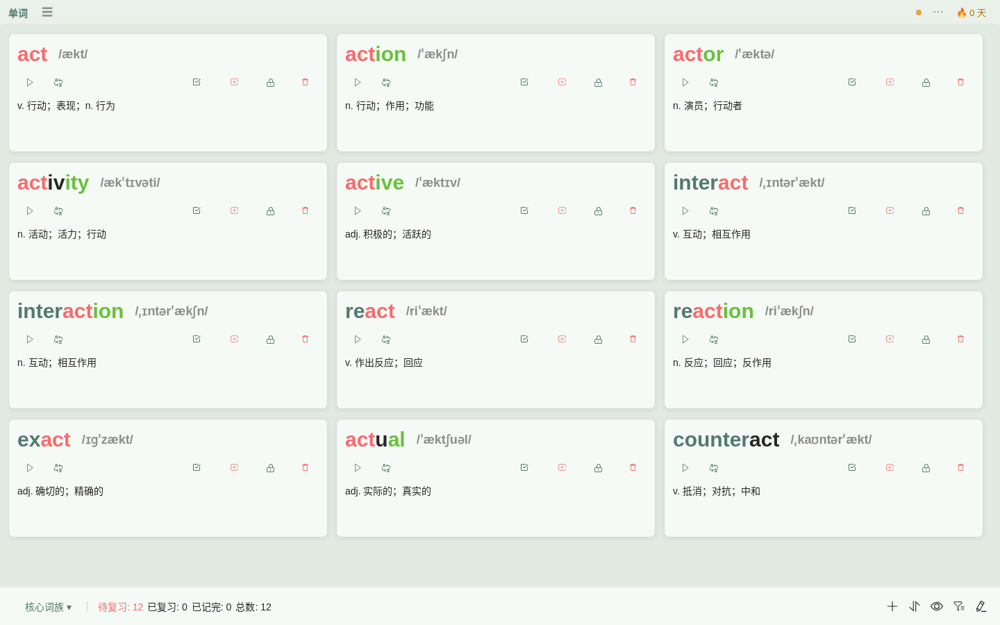

底部状态栏实时统计：待复习 / 已复习 / 已记完 / 总数。

### 4.2 功能入口（☰ 抽屉）

顶部「☰」抽屉汇聚全部模块，常用入口按使用频率自动上浮；「⋯」打开全局设置。

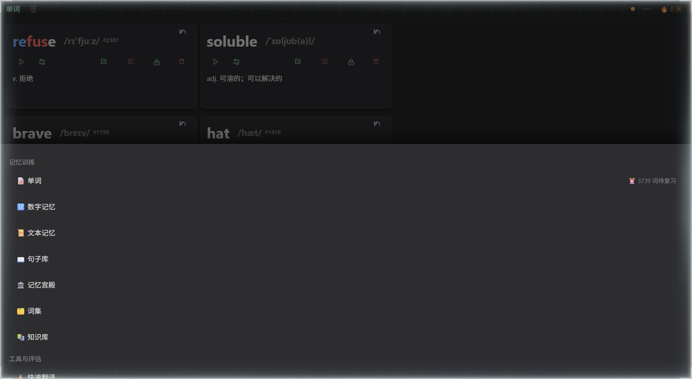

uTools 下也可直接呼出主输入框输入关键字直达功能：`mj`/`慢记`（复习）、`翻译`/`fy`、`文本记忆`、`数字记忆`、`记忆宫殿`、`知识库`、`快捷键记忆`、`记忆测试`、`专注`、`截图添加` 等。

### 4.3 快速翻译

15+ 翻译引擎（有道/百度/阿里/腾讯/DeepSeek/Kimi/通义/GLM/MiniMax/混元/uTools AI/Ollama/本地词典等），支持语种互换、粘贴图片 OCR 翻译、近反义词与例句；输入框支持直接粘贴图片识别翻译。

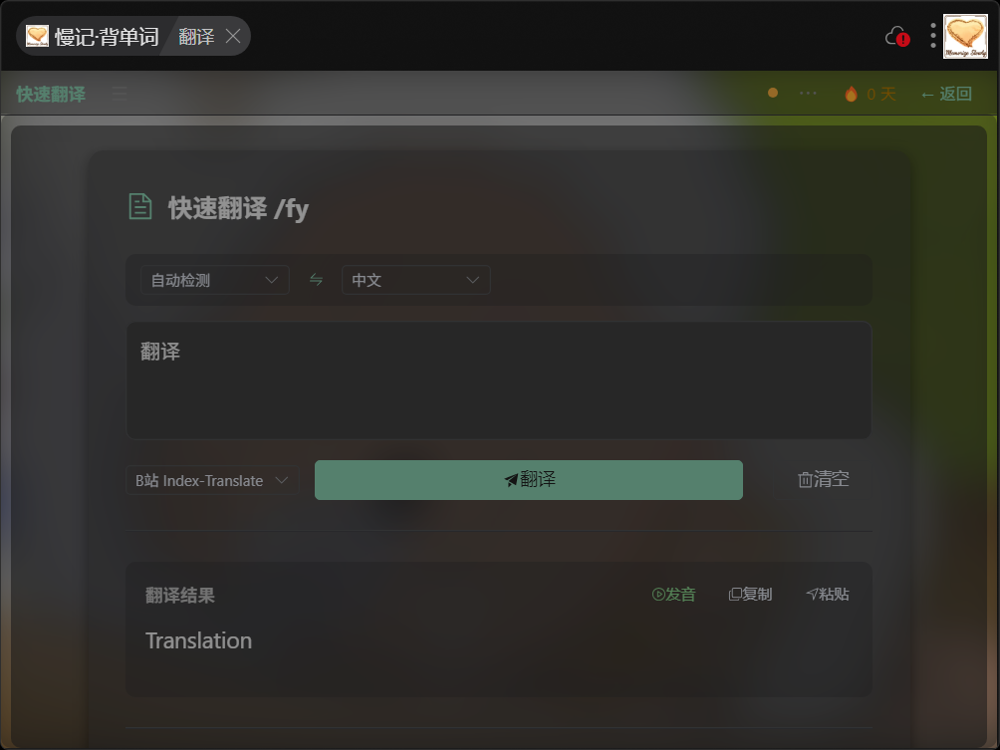

### 4.4 文本记忆

诗词、文章、知识点的导入管理与背诵练习。列表 / 地图 / 时间线三视图；内置 428 首诗词、160 条成语、336 个历史时间线事件；支持跟打练习、四种策略填空练习、学习笔记、提示词、地理标记、专注显示。

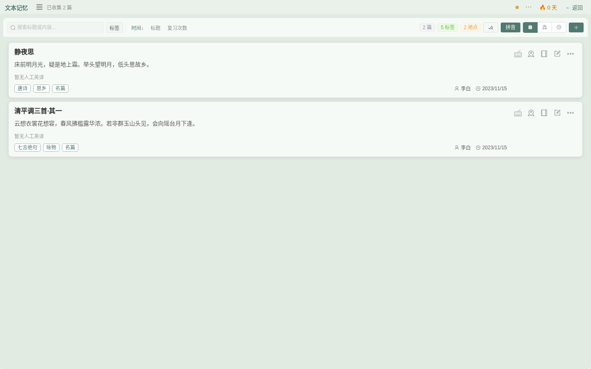

### 4.5 数字记忆训练

0-99 数字图像编码（如 15=鹦鹉），支持一键导入预设映射、映射表导出打印、三种训练模式（数字→图片 / 图片→数字 / 随机序列）、数字记忆条目（电话/纪念日）与训练历史。

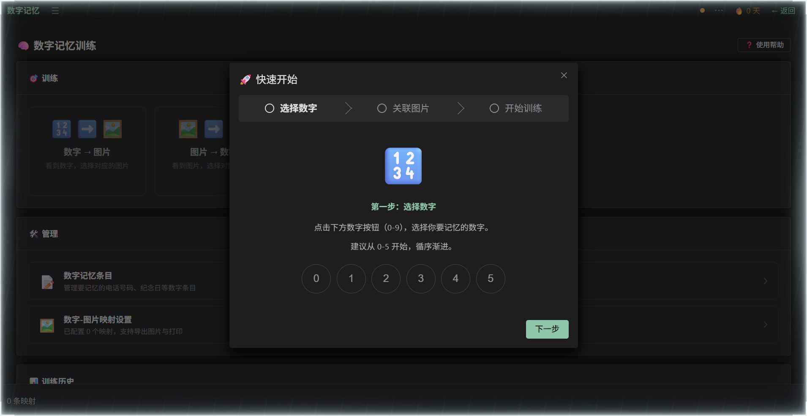

### 4.6 记忆宫殿

轨迹法四件套：内置桩库一键导入（数字桩/家居路线/身体桩/二十四节气/生肖/地支/王朝等）、桩位拖拽编辑与配图、宫殿详情、按桩过一遍（记住/忘记自评，按遗忘曲线安排复习）。

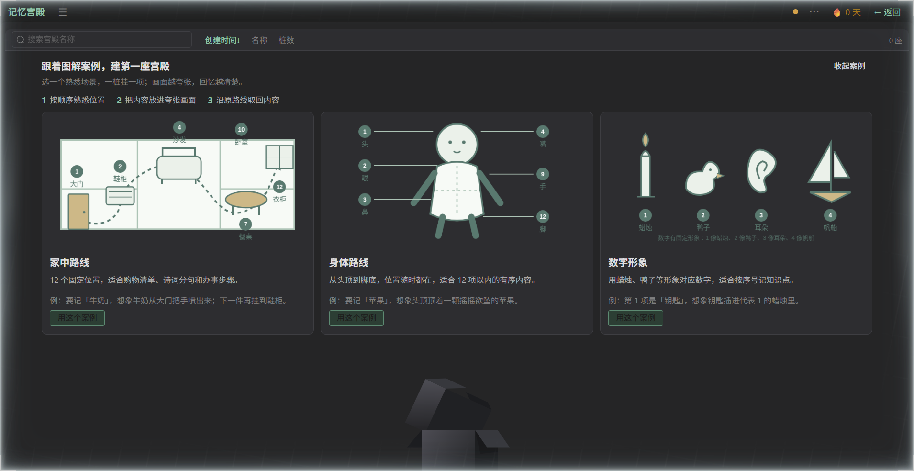

### 4.7 知识库

35 个内置知识包（桩库 / 数理化 / 文史常识三类），五种练习模式（Q→A 翻卡 / A→Q 反向 / 四选一 / 输入 / 顺序回忆）；公式类条目带交互函数图像，化学方程式带现象动画；整包支持打印与导出长图。

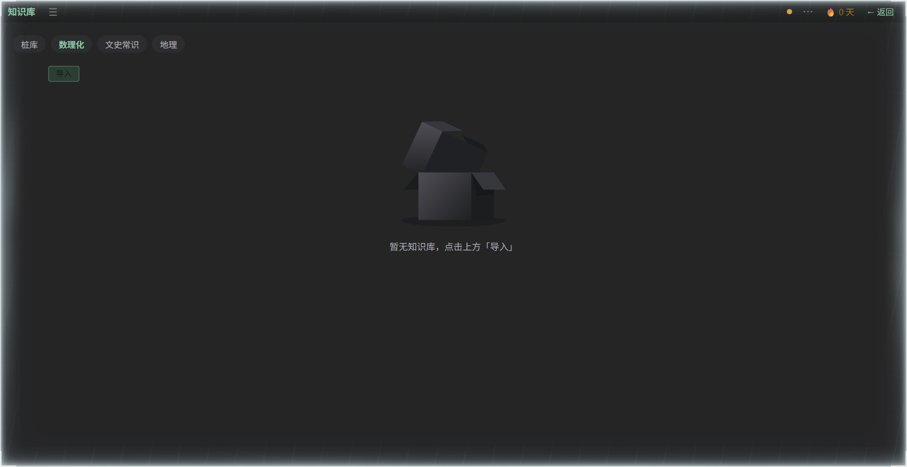

### 4.8 快捷键记忆

系统/开发/办公/设计/财务五大领域 + 输入法（五笔 86/98、双拼小鹤/自然码/微软/搜狗），按键训练/反向训练/错题训练三种模式，五笔双拼支持「类型 + 分区」两维专项标签筛选与悬浮键盘。

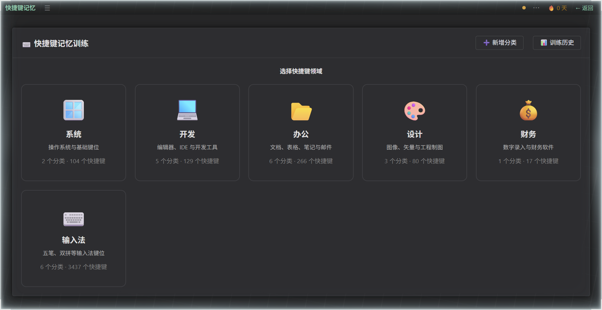

### 4.9 记忆测试

数字记忆、单词记忆、图案记忆、词汇量测试四种模式；词汇量测试支持 CET-4/6、雅思、托福、GRE、JLPT N5-N1、CEFR 多阶梯，多轮抽样估算词汇量并给出阅读推荐。

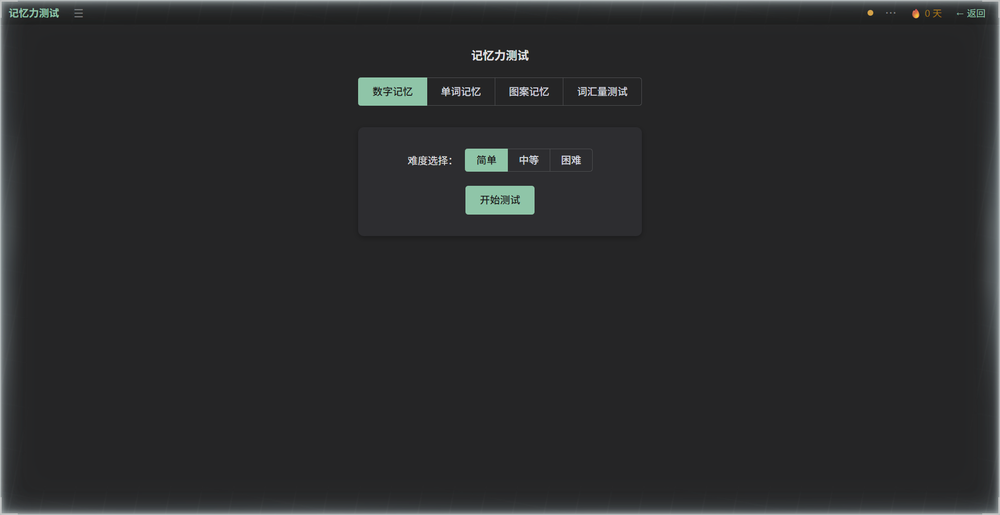

### 4.10 拼写练习（听写）

看释义或听发音默写单词，支持「给一半字母」提示与全盲模式，范围可选全部/待复习/最近添加，自动保存进度。

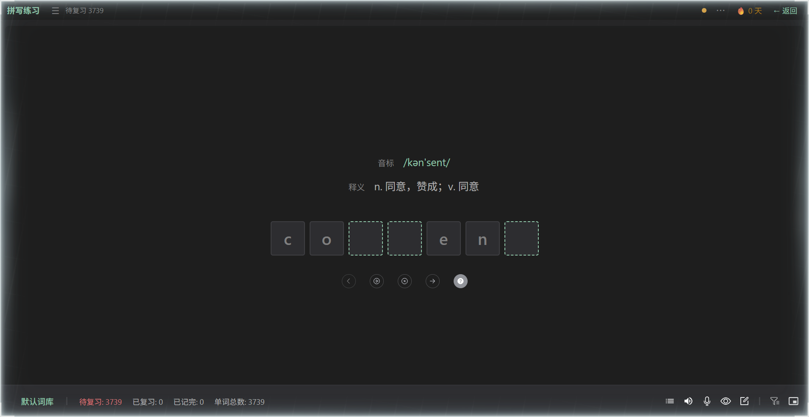

### 4.11 音标学习

按词库语言自动切换数据集（英语 48 国际音标 / 日语五十音 103 条 / 俄语 33 字母 / 西语法语发音集），四种训练模式：音标识别、反向识别、辨音练习、音素拆解。

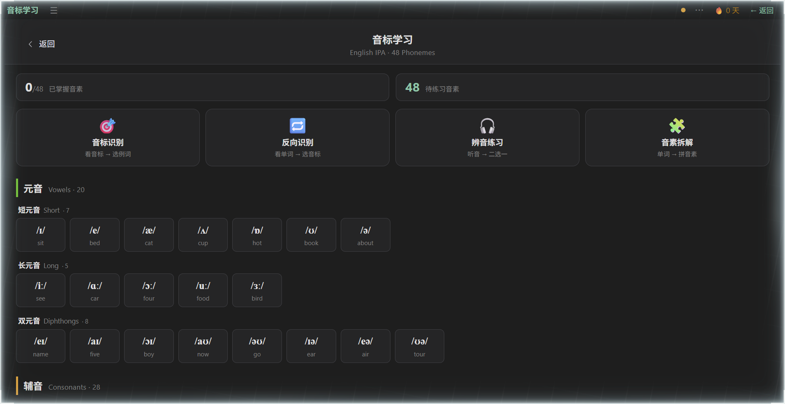

### 4.12 专注模式（uTools / Electron 专属）

迷你悬浮窗贴边复习，支持置顶、贴边隐藏、透明度、锁定（鼠标穿透）、标准/拼写/听写三种模式，字体颜色/字号/背景图自定义；uTools 8.0 起支持定时任务（定时复习提醒、防断签、每日静默备份）。

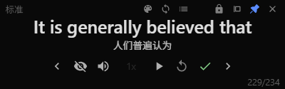

### 4.13 设置与多端同步

「⋯」设置抽屉：常规（引擎/字号/护眼模式/透明度）、专注模式样式、全局快捷键、各引擎密钥配置、外观（自定义背景图 + 亚克力效果）。

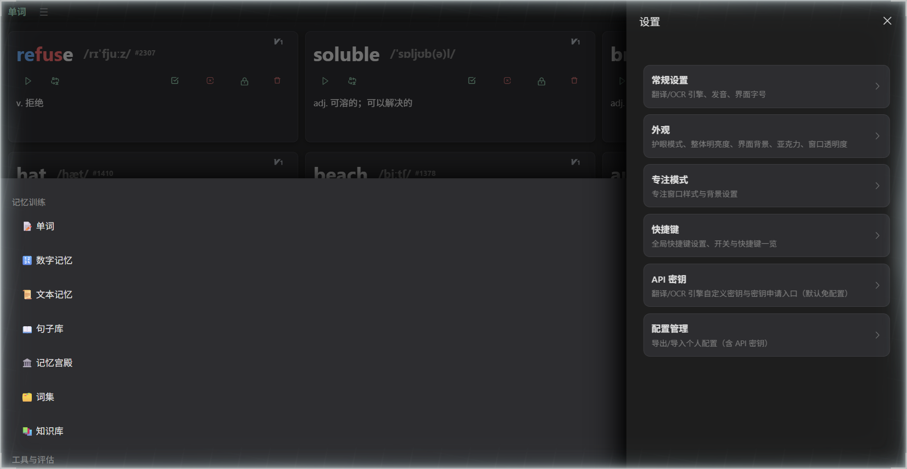

多端同步三方式：**坚果云 WebDAV**（长期加密备份）、**服务器同步**（AES-256 端到端加密，同步码一次性互传）、**文件同步**（导出导入）。同步内容覆盖全部词库、各记忆模块数据与用户设置。

---

## 五、开发与发布

### 5.1 本地开发

```bash
npm install                # 桌面端依赖
npm run dev                # uTools 开发服务器（端口 3000，plugin.json 指向 localhost:3000）
npm run dev:web            # Web 版开发
npm run dev:electron       # Electron 开发
cd mobile && npm install   # 移动端依赖
```

uTools 开发环境：uTools「开发者工具」资源目录指向项目（或 `D:\slowlyRecord-dist`），呼出 uTools 输入 `慢记`/`mj` 即可调试。

### 5.2 发布

```bash
npm run build:upx          # 构建并拷贝到 D:\slowlyRecord-dist（uTools 开发环境/打包）
npm run pack:electron      # electron-builder 产出安装包（release/）
npm run build:web          # dist-web/ + SEO 静态页（正式部署设 SITE_ORIGIN）
npm run build:mp-weixin    # 微信小程序（mobile/）
```

### 5.3 重点版本记录

| 版本 | 日期 | 要点 |
|------|------|------|
| v1.3.5 | 2026.11 | 新增词集导图与页级复习；修复复习误结算、导入取消卡住、级联删除与同步误报成功、删除复活、示例归属和草稿丢失；小窗口导图自适应 |
| v1.3.1 | 2026.10 | 外观设置（自定义背景/亚克力）、uTools 8.0 定时任务、uTools AI 引擎、桩库与知识包扩充（50 个新包） |
| v1.3.0 | 2026.09 | 同步可靠性（删除不再复活）、包体缩小启动加速、学习打卡（目标/热力图/成就）、日俄西法词库 |
| v1.2.1 | 2026.09 | 术语统一、知识包三类调整、字号三档缩放、坚果云 WebDAV 同步、句子库收藏同步 |

完整版本历史见 `CHANGELOG.md`，使用教程见 `README.md` 与 `docs/tutorial.md`。

---

## 六、截图文件清单

发布页最多 8 张截图，按“核心使用 → 新功能 → 差异化能力 → 工作流”排序：

| 文件 | 平台 | 内容 |
|------|------|------|
| `screenshots/utools/u01-word-review.png` | uTools | 单词复习列表 |
| `screenshots/utools/u02-word-book.png` | uTools | 词集导图与页级复习 |
| `screenshots/utools/u03-dictation.png` | uTools | 拼写练习 |
| `screenshots/utools/u04-text-memory.png` | uTools | 文本记忆 |
| `screenshots/utools/u05-knowledge.png` | uTools | 知识库 |
| `screenshots/utools/u06-memory-palace.png` | uTools | 记忆宫殿 |
| `screenshots/utools/u07-focus-mode.png` | uTools | 专注模式 |
| `screenshots/utools/u08-sync.png` | uTools | 多端同步 |
| `screenshots/web/02-menu-drawer.png` | Web | 功能菜单抽屉 |
| `screenshots/web/05-number-memory.png` | Web | 数字记忆 |
| `screenshots/web/06-memory-palace.png` | Web | 记忆宫殿 |
| `screenshots/web/07-knowledge.png` | Web | 知识库 |
| `screenshots/web/08-shortcut.png` | Web | 快捷键记忆 |
| `screenshots/web/09-memory-test.png` | Web | 记忆测试 |
| `screenshots/web/10-settings.png` | Web | 设置抽屉 |
| `screenshots/web/11-dictation.png` | Web | 拼写练习 |
| `screenshots/web/12-phonetic.png` | Web | 音标学习 |
