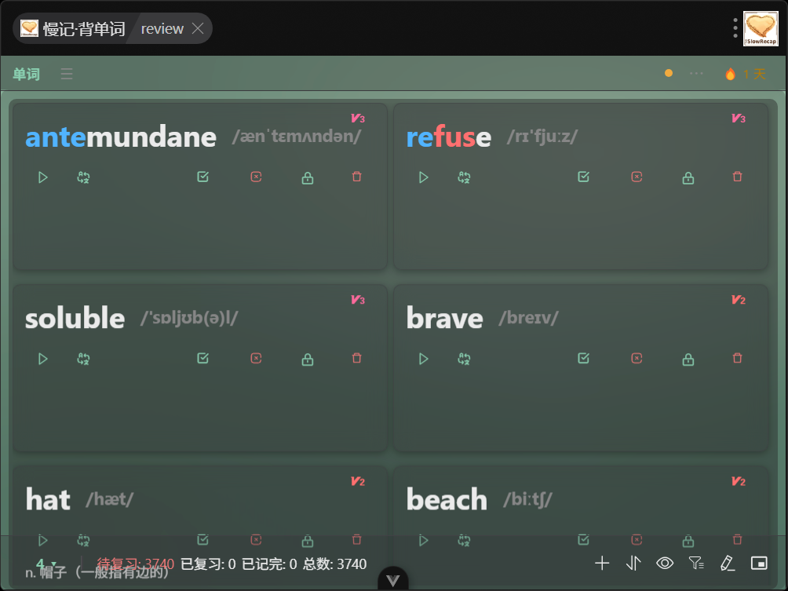
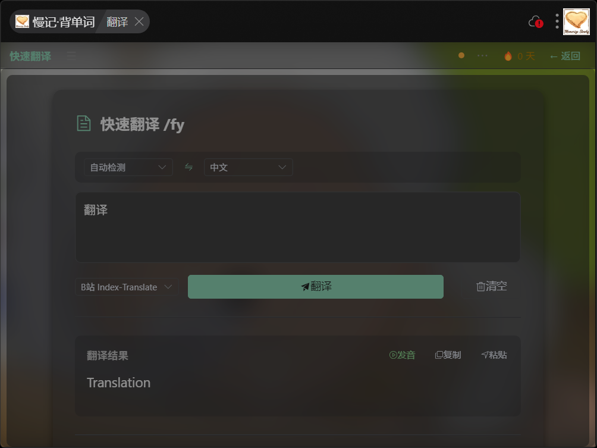
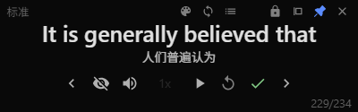
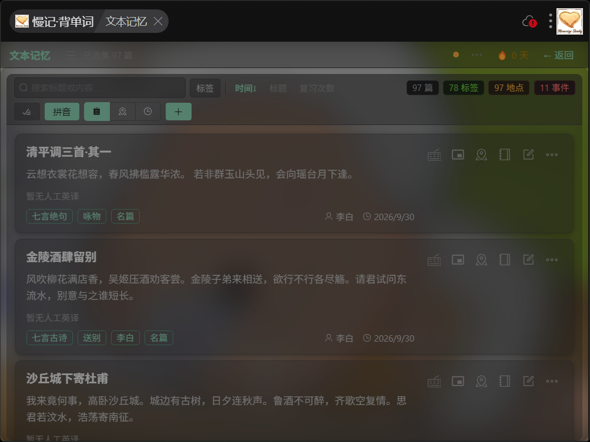

# 慢记用户手册 · uTools 端

> 本册只讲 uTools 端的进入方式与专属功能。产品理念与数据模块见 [公共核心](00-common.md)。

---

## 一、安装与进入

1. 在 uTools 插件市场搜索「慢记」安装（开发版可通过 uTools 开发环境加载插件目录）。
2. 唤起 uTools 主输入框（默认 Alt+Space），输入关键字：

| 关键字 | 效果 |
| --- | --- |
| `慢记` | 打开主界面（单词复习） |
| `翻译` | 直达快速翻译 |
| `review` | 直达单词复习 |
| `划词添加` | 划词相关入口 |
| 任意文本/单词 + 回车 | 把该文本加入单词复习列表 |

> 提示：输入普通文本回车即「加入复习列表」，这是 uTools 插件的标准用法。

## 二、主界面：单词复习

- 每条卡片显示单词/短语、音标、释义和操作按钮：朗读、加入复习、标记掌握程度、锁句、删除等。
- 底部工具栏：筛选（句子▾）、统计（待复习/已复习/已记完/总数）、排序与视图切换。
- 顶栏右侧 🔥 显示连续打卡天数。

## 三、☰ 功能菜单（抽屉导航）

点左上角 ☰ 打开功能菜单，分组如下（在抽屉内上下滚动查看全部）：

- **记忆训练**：单词 · 知识库 · 文本记忆 · 数字记忆 · 句子库 · 记忆宫殿
- **工具与评估**：快速翻译 · 记忆力测试
- **辅助**：字母映射 · 音标学习 · 快捷键记忆
- **数据**：导入 / 导出 · 同步与备份 · 设置

子页面左上角提供「← 返回」回到单词主页。抽屉打开时用 Escape 或点击遮罩关闭。

## 四、⋯ 设置抽屉

点右上角 ⋯ 打开设置，分组：

- **常规设置**：翻译/OCR 引擎、发音、界面字号
- **外观**：护眼模式、整体明亮度、界面背景（可自定义背景图）、亚克力、窗口透明度
- **专注模式**：专注窗口样式与背景设置
- **快捷键**：全局快捷键设置与一览
- **API 密钥**：翻译/OCR 引擎自定义密钥（默认免配置）
- **配置管理**：导出/导入个人配置（含 API 密钥）

## 五、uTools 端专属功能

### 快速翻译

输入文本即时翻译，支持多种翻译引擎（引擎与密钥在设置中配置）。也可在 uTools 输入框输 `翻译` 直达。

### 划词添加

在任意应用选中文字后通过「划词添加」把词加入复习列表。

### 专注模式

一个小尺寸悬浮窗（约 400×125），用于极简专注场景，样式与背景可在设置 → 专注模式 中调整。

### 自定义背景图与外观

设置 → 外观 可开启护眼模式、自定义界面背景图、亚克力与窗口透明度，uTools 窗口会实时应用。

## 六、文本记忆与知识库

- **文本记忆**：把古诗词等长文本逐篇加入复习，支持标签、作者、时间、地点、事件维度组织与筛选。
  
- **知识库**：内置知识包（小九九/大九九乘法表、元素周期表等）开箱即练，也支持自定义导入。

---

[← 公共核心](00-common.md) ｜ [Web 端](02-web.md) ｜ [小程序端](03-miniprogram.md)
