# 慢记用户手册 · Web 端

> 本册只讲 Web 端。产品理念与数据模块见 [公共核心](00-common.md)；uTools 专属功能（划词添加、专注悬浮窗、原生窗头外观）见 [uTools 分册](01-utools.md)。

---

## 一、访问方式

Web 版部署后通过浏览器直接访问对应网址即可，无需安装。界面与 uTools 端共用同一套设计，操作逻辑基本一致（☰ 功能菜单、⋯ 设置抽屉），差异如下：

- 无 uTools 原生窗口头，页头为应用自绘标题栏；
- 无「划词添加」「专注模式悬浮窗」等 uTools 专属能力；
- 支持直接通过 URL 定位页面，例如 `…/index.html#/translate` 直达快速翻译。

## 二、页面导览

### 单词复习（首页）

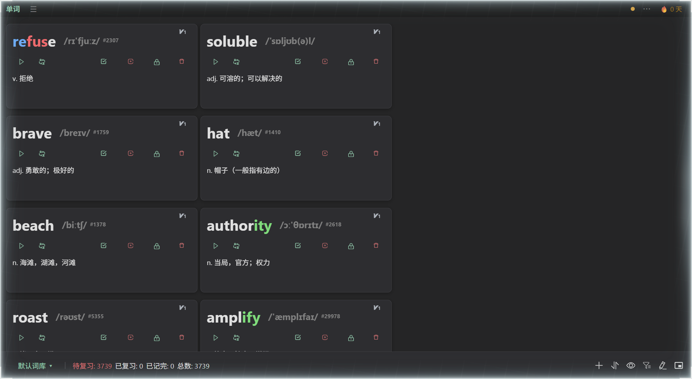

卡片式复习列表，操作按钮与统计同 uTools 端（见 [uTools 分册 · 主界面](01-utools.md#二主界面单词复习)）。

### 功能菜单抽屉

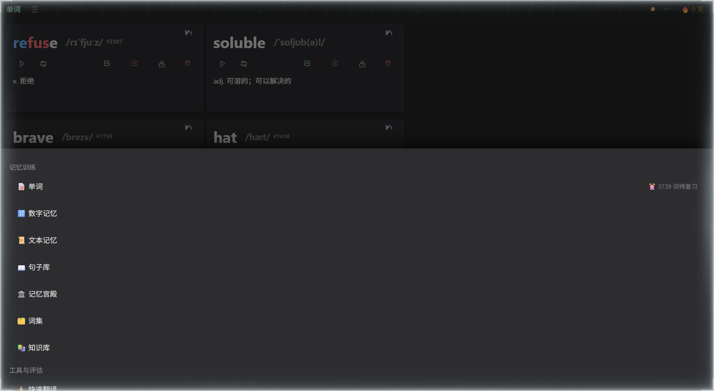

左上角 ☰ 打开，分组：记忆训练（单词/知识库/文本记忆/数字记忆/句子库/记忆宫殿）、工具与评估（快速翻译/记忆力测试）、辅助（字母映射/音标学习/快捷键记忆）、数据（导入导出/同步备份/设置）。

### 快速翻译

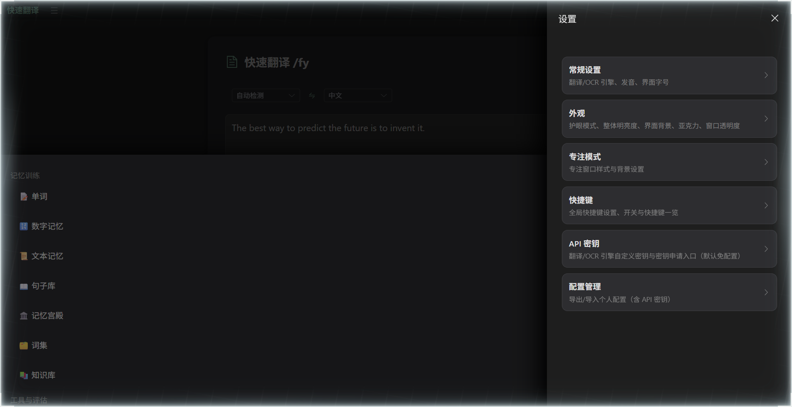

### 文本记忆

### 数字记忆

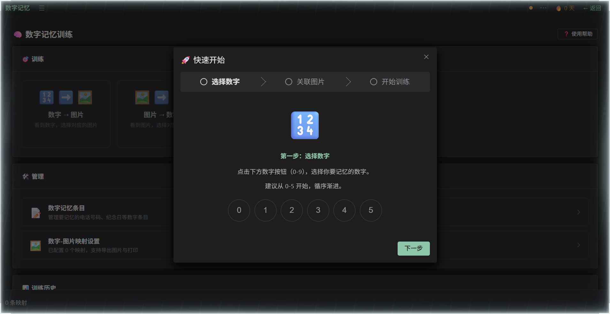

字母映射转码 + 关联图片 + 分步训练向导。

### 记忆宫殿

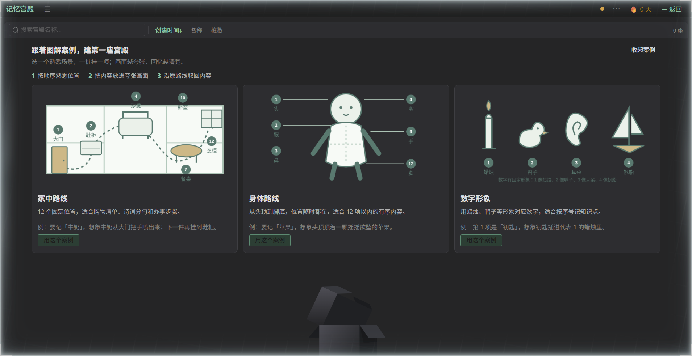

### 知识库

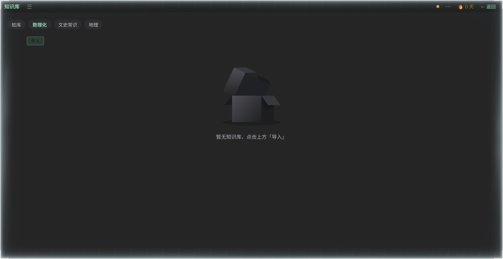

内置知识包开箱即练（乘法表、元素周期表等）。

### 快捷键记忆

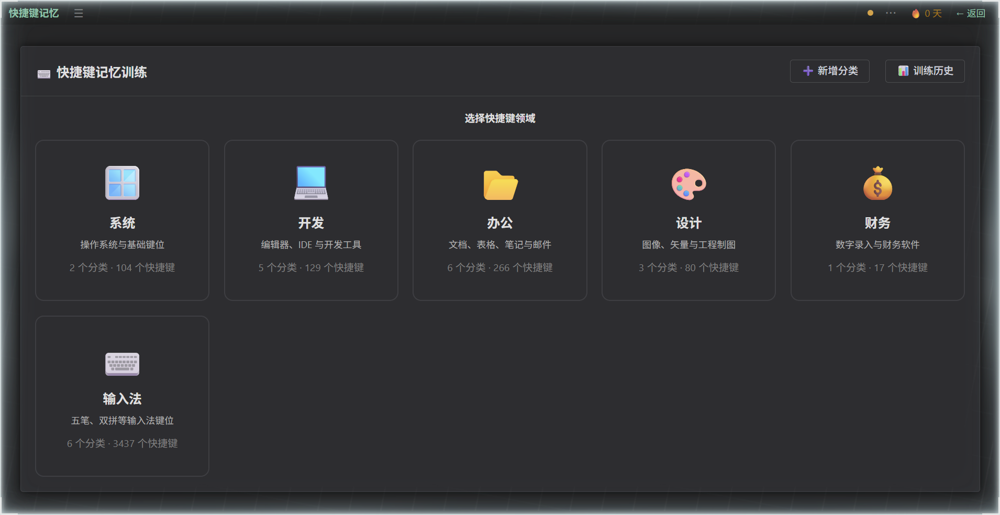

### 记忆力测试

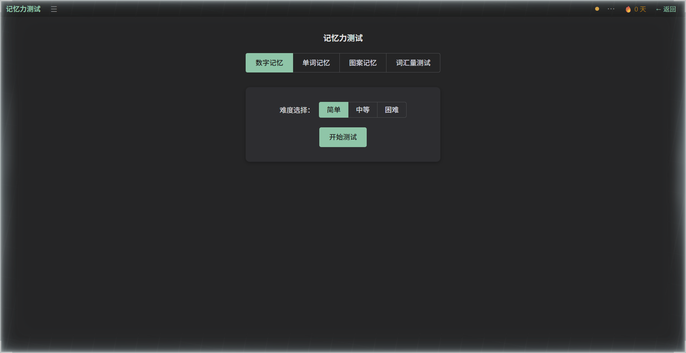

### 听写练习（拼写）

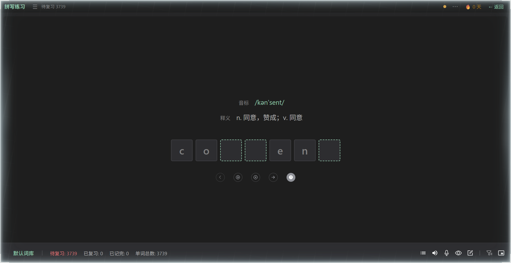

### 音标学习

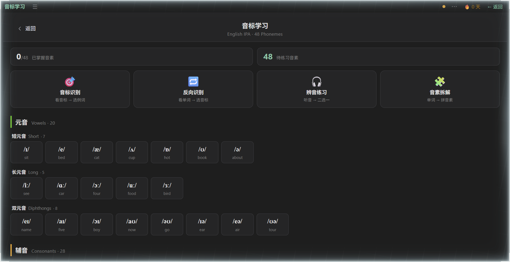

### 句子库

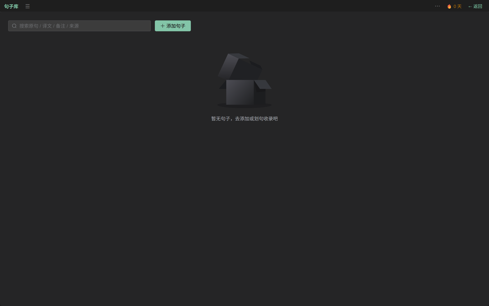

复习单词时收录的例句集中管理，支持按原句/译文/备注/来源搜索。

### 字母映射

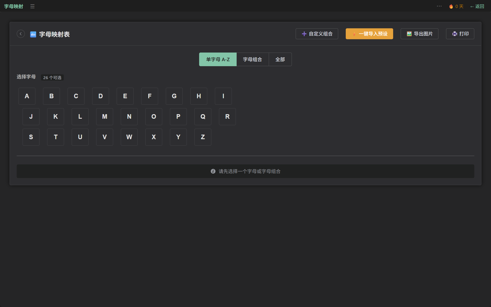

数字记忆的基础：为 A-Z 建立图像映射，支持自定义组合、一键导入预设、导出图片与打印。

### 打卡

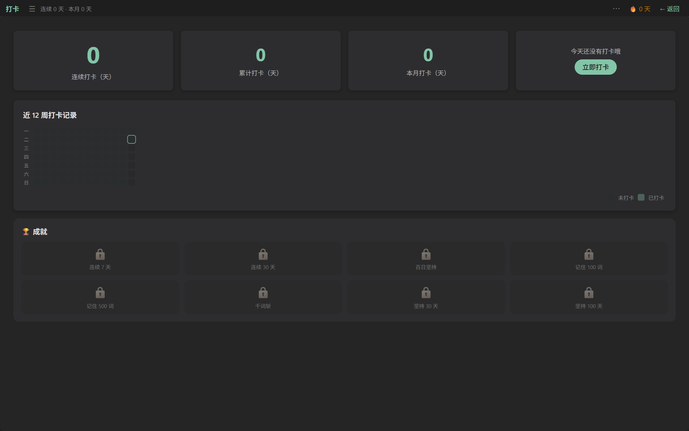

连续/累计/本月打卡统计、近 12 周打卡热力图与成就系统。

### 设置抽屉

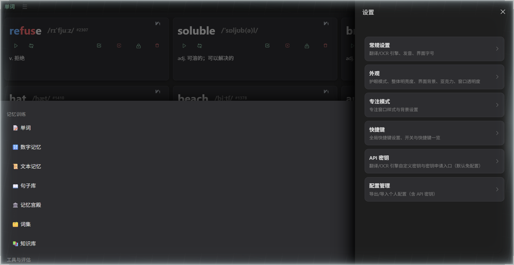

右上角 ⋯ 打开：常规设置 / 外观 / 专注模式 / 快捷键 / API 密钥 / 配置管理。

## 三、数据与同步

Web 端数据保存在浏览器本地（IndexedDB）。清理浏览器站点数据会清除本地数据，请定期用 设置 → 导入/导出 或 同步与备份 做备份。详见 [公共核心 · 数据存储与同步](00-common.md#四数据存储与同步)。

---

[← 公共核心](00-common.md) ｜ [uTools 端](01-utools.md) ｜ [小程序端](03-miniprogram.md)
